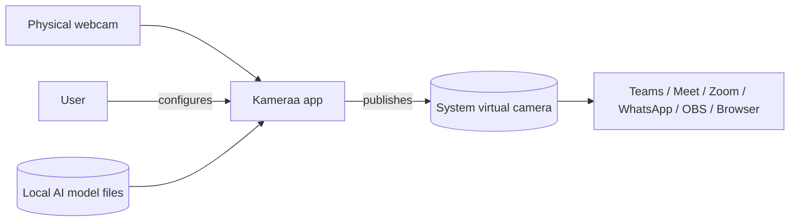
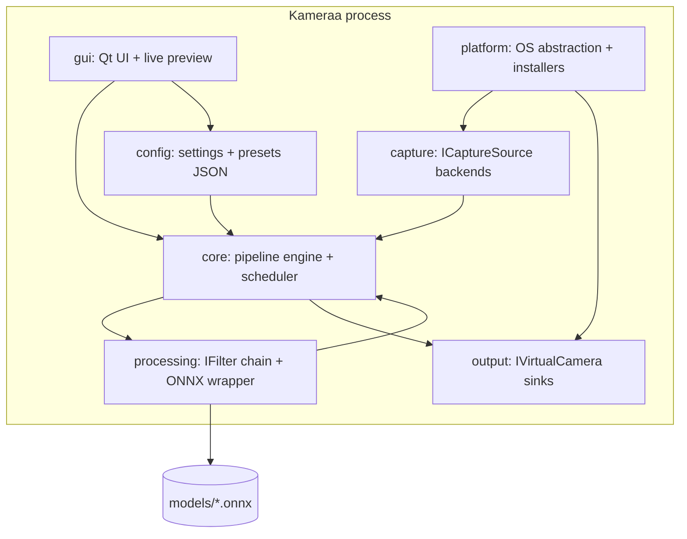
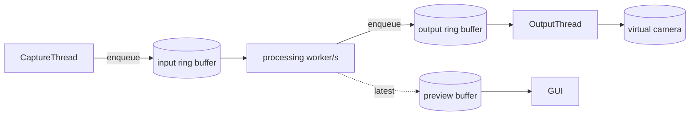

# 03 — Architecture & System Design

## 1. Overview
Kameraa is a single C++ desktop application structured as a **pipeline**: a capture
source produces frames, a chain of **filters** enhances them, and a **virtual camera
sink** publishes them to the OS. A Qt GUI drives configuration and shows a live
preview. OS-specific concerns (capture, virtual camera, GPU) sit behind interfaces.

## 2. System context (C4 — Level 1)



Everything is local. No cloud boundary is crossed.

## 3. Containers / modules (C4 — Level 2)



### Module responsibilities
- **core/** — owns the `Pipeline`: frame buffers (ring/queue), the worker scheduler,
  timing/latency budget, and orchestration of capture → filters → output. Defines
  the `Frame` type and core interfaces.
- **capture/** — `ICaptureSource` implementations: `OpenCvCaptureSource` (MVP),
  later `MediaFoundationCaptureSource`, `AVFoundationCaptureSource`, `V4L2CaptureSource`.
- **processing/** — `IFilter` interface + concrete filters (denoise, relight, sharpen,
  super-res, background, face). `OnnxModel` wraps ONNX Runtime sessions and execution
  providers.
- **output/** — `IVirtualCamera` implementations: `V4L2LoopbackSink` (first),
  `DirectShowSink` (Windows), `CmioExtensionSink` (macOS).
- **platform/** — capabilities detection (GPU, backend presence), install/registration
  helpers, OS paths.
- **gui/** — Qt widgets: device/preset pickers, effect toggles/sliders, preview,
  status; talks to `core` via a thin controller, never to filters directly.
- **config/** — load/save settings + preset definitions (JSON); schema-validated.
- **app/** — entry point, wiring, lifecycle.

## 4. Key interfaces (conceptual)

```cpp
// core/Frame.h
struct Frame {
    cv::Mat image;            // BGR (or configurable)
    int64_t timestampUs;
    int width, height;
};

// core/ICaptureSource.h
class ICaptureSource {
public:
    virtual ~ICaptureSource() = default;
    virtual bool open(const CaptureConfig&) = 0;
    virtual bool read(Frame& out) = 0;   // blocking or latest-frame
    virtual void close() = 0;
    virtual std::vector<CameraInfo> enumerate() = 0;
};

// processing/IFilter.h
class IFilter {
public:
    virtual ~IFilter() = default;
    virtual std::string name() const = 0;
    virtual void setEnabled(bool) = 0;
    virtual bool isEnabled() const = 0;
    virtual void configure(const FilterParams&) = 0;
    virtual void process(Frame& inOut) = 0;  // in-place or swap
};

// output/IVirtualCamera.h
class IVirtualCamera {
public:
    virtual ~IVirtualCamera() = default;
    virtual bool start(const OutputConfig&) = 0;
    virtual bool isAvailable() const = 0;   // backend installed?
    virtual bool pushFrame(const Frame&) = 0;
    virtual void stop() = 0;
};
```

## 5. Threading model



- **Capture thread:** pulls frames, always keeps only the latest (drop stale).
- **Processing worker(s):** run the filter chain. Single worker by default to keep
  ordering/latency predictable; optional pool for independent per-frame work.
- **Output thread:** paces frames to the virtual cam at target fps.
- **Preview:** GUI reads the latest processed frame; never blocks the pipeline.
- Bounded buffers + frame-dropping guarantee realtime over completeness.

## 6. Data flow per frame
`capture → (to RGB/working format) → denoise → relight/color → sharpen →
super-res → face-restore(region) → background → [interpolation] → encode/format →
virtual cam`. Order is fixed and documented; see [04-PIPELINE-DESIGN.md](04-PIPELINE-DESIGN.md).

## 7. Configuration & presets
- Presets (Lite/Balanced/Studio) are JSON: which filters are enabled, their params,
  model tier, and target in/out resolution + fps.
- User overrides are layered on top of a preset and persisted.

## 8. Error handling & degradation
- Missing virtual-cam backend → GUI blocks "Start" and shows install guidance.
- Camera lost → pipeline emits a placeholder frame, attempts reconnect.
- Stage over budget → scheduler downscales working resolution, skips optional stages,
  or drops frames (configurable policy) to hold target fps.

## 9. Cross-cutting concerns
- **Logging:** lightweight, local, level-controlled; no frame contents logged.
- **Metrics:** per-stage timing, fps, dropped frames — surfaced in GUI.
- **Security:** validate model files and config at boundaries; no network path in the
  processing loop.

## 10. Directory layout
```
kameraa/
  CMakeLists.txt
  README.md
  docs/
  src/
    app/            # main, wiring
    core/           # Frame, Pipeline, interfaces, scheduler
    capture/        # capture backends
    processing/     # filters + OnnxModel
    output/         # virtual camera sinks
    platform/       # OS detection, installers
    gui/            # Qt UI
    config/         # settings + presets
  models/           # bundled .onnx (+ LICENSES)
  assets/           # icons, test images
  tests/            # unit/integration tests
  cmake/            # helper modules, toolchains
```

## 11. Requirement → module mapping
| Requirement area | Module(s) |
|------------------|-----------|
| Capture (FR-C*) | capture, core |
| Enhancement (FR-E*) | processing, core |
| Virtual cam (FR-O*) | output, platform |
| GUI (FR-U*) | gui, config |
| Platform/setup (FR-P*) | platform, output |
| Performance (NFR-P*) | core (scheduler), processing |
