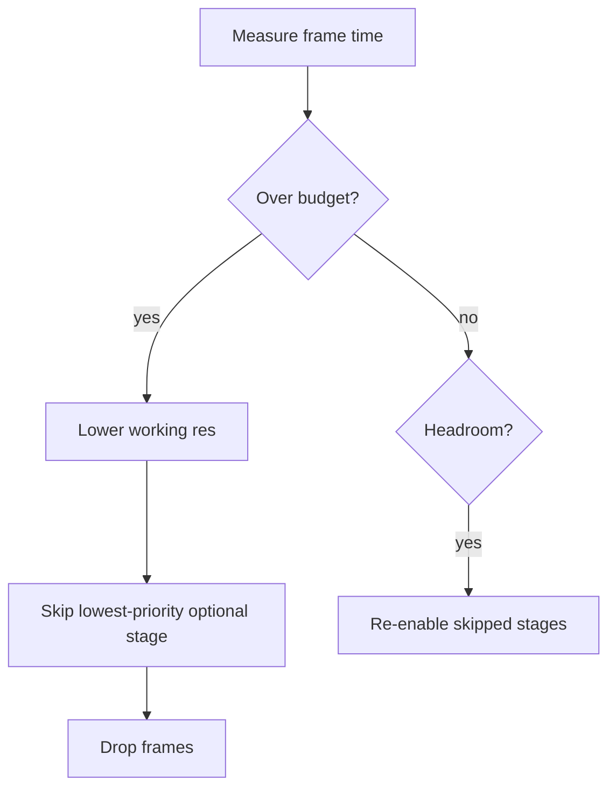

# 04 — Pipeline Design

## 1. Goals
A deterministic, modular, realtime frame pipeline that can add/remove effects without
breaking ordering, and that **degrades gracefully** to preserve smooth output.

## 2. Fixed stage order
Order matters for quality. The canonical order:

1. **Capture / ingest** — acquire frame, convert to working format (e.g. BGR/RGB,
   optionally float).
2. **Denoise** — remove sensor grain *before* any sharpening/upscaling (so we don't
   amplify noise).
3. **Relight / color** — exposure, white balance, tone curve, saturation, gamma.
4. **Sharpen** — mild detail enhancement (skipped if super-res handles it).
5. **Super-resolution** — upscale to target output resolution.
6. **Face restore / beautify** — applied to detected face region(s) only.
7. **Background** — matte → blur or replace (after subject looks good).
8. **Frame interpolation** *(optional)* — synthesize intermediate frames for higher fps.
9. **Format / encode** — convert to the pixel format the virtual cam sink needs.
10. **Output** — push to virtual camera.

Each of 2–8 is an optional `IFilter`; disabling one is a no-op pass-through.

## 3. Threading & buffering
- One **capture thread**: grabs frames, pushes the *latest* into a size-1 (or small)
  input slot, dropping stale frames (we never queue a backlog of old frames).
- One **processing worker** (default): runs stages 2–9 in order. Keeps latency
  predictable and ordering trivial. Optional multi-worker mode for throughput on
  many-core machines (requires reordering by timestamp).
- One **output thread**: paces frames to the sink at target fps; repeats last frame if
  the pipeline underruns, so apps always see a steady stream.
- **Preview** taps the latest processed frame without blocking.
- All queues are **bounded**; overflow policy = drop oldest.

## 4. Latency budget (Balanced preset, illustrative target)
Total added latency target: **< ~150 ms**. Rough per-stage CPU budget at 1080p:

| Stage | Budget (ms) | Notes |
|-------|-------------|-------|
| Capture + convert | 5–15 | driver dependent |
| Denoise | 5–20 | classical cheap; AI heavy |
| Relight / color | 2–8 | classical, cheap |
| Sharpen | 1–3 | unsharp mask |
| Super-res | 10–40 | lightweight model / tile |
| Face restore | 10–30 | face region only, gated |
| Background | 10–30 | matting model |
| Interpolation | off in Balanced | GPU-leaning |
| Format + push | 2–8 | |

Budgets are enforced by the scheduler (Section 6). Exact numbers to be replaced by
measured values — see [08-PERFORMANCE.md](08-PERFORMANCE.md).

## 5. Presets
| Preset | Target | Typical enabled stages | Model tier |
|--------|--------|------------------------|------------|
| **Lite** | max fps, low CPU | denoise(classical), relight, sharpen | none/tiny |
| **Balanced** | 30–60fps @1080p | denoise, relight, sharpen, light super-res, bg blur | small AI |
| **Studio** | best look, GPU preferred | all incl. face restore, strong super-res, bg replace, interp | full AI |

Presets are JSON (see [07-TECH-STACK.md](07-TECH-STACK.md) for schema location). The
user may toggle individual stages on top of a preset.

## 6. Adaptive scheduler (graceful degradation)
The scheduler measures per-frame processing time and compares to the frame period for
the target fps. When over budget, it applies, in order:
1. Reduce **internal working resolution** (process smaller, upscale at output).
2. **Skip optional stages** by priority (interpolation → background → super-res →
   face → …) until within budget.
3. **Drop frames** (process every Nth) as a last resort.
When headroom returns, it restores stages. This guarantees the output thread always
has fresh frames and the stream stays smooth.

## 7. Color & format handling
- Internal working format: 8-bit BGR by default; float32 where a model needs it.
- Explicit conversions at ingest and before output; avoid repeated conversions
  between stages (filters agree on the working format).
- Output format negotiated with the sink (e.g. NV12/YUY2 for virtual cams).

## 8. Face region gating
- A lightweight detector (YuNet) runs at reduced frequency (e.g. every few frames)
  and tracks between detections.
- Face-restore/beautify only process the detected ROI, then blend back — big CPU
  savings vs full-frame.

## 9. Testability
- Each filter is pure: `Frame in → Frame out`, no global state, unit-testable with
  fixture images (PSNR/SSIM assertions where meaningful).
- The pipeline can run headless with a file/image source for CI
  (see [13-TESTING.md](13-TESTING.md)).
