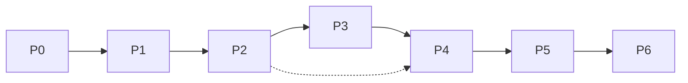

# 11 — Roadmap

Phased plan. Each phase ends with something runnable and testable. "First OS" for the
virtual camera is **Linux (v4l2loopback)** because it is the easiest sink; the GUI and
capture are cross-platform from the start (user's primary OS is Windows, which is the
second virtual-cam target).

## Phase 0 — Skeleton & capture (foundation)
- [ ] CMake project, module targets, vcpkg manifest, presets.
- [ ] Qt window with a live **preview** widget.
- [ ] `ICaptureSource` + `OpenCvCaptureSource`; camera enumeration + selection.
- [ ] Core `Frame` type, basic single-thread pipeline (capture → preview).
- **Exit:** app opens, lists cameras, shows live raw preview on Win/Linux/mac.

## Phase 1 — Virtual camera MVP (passthrough)
- [ ] `IVirtualCamera` interface + threading (capture/processing/output).
- [ ] **Linux `V4L2LoopbackSink`**: push raw frames → selectable in Zoom/Meet/OBS.
- [ ] Backend detection + install guidance (FR-P1).
- [ ] Start/Stop control in GUI.
- **Exit:** raw webcam appears as "Kameraa" virtual camera in a real call app (Linux).

## Phase 2 — Classical enhancement + presets
- [ ] `IFilter` chain + ordering + enable/disable.
- [ ] Denoise (classical), relight/color (auto WB, exposure, tone), sharpen.
- [ ] Preset system (Lite/Balanced/Studio) + JSON config persistence.
- [ ] Per-effect sliders, before/after preview, metrics bar.
- [ ] Adaptive scheduler v1 (resolution scaling + frame drop).
- **Exit:** visible quality improvement, smooth output, settings persist.

## Phase 3 — AI stages (CPU-first)
- [ ] `OnnxModel` wrapper + execution-provider selection + warm-up.
- [ ] Super-resolution (ESPCN/FSRCNN) with tiling.
- [ ] Background matting (MODNet) → blur/replace.
- [ ] Optional AI denoise / low-light (license-cleared).
- [ ] Model manifest + sha256 integrity check.
- **Exit:** AI upscale + background on CPU within Balanced budget.

## Phase 4 — Windows virtual camera + face enhance
- [ ] **Windows `DirectShowSink`** (COM filter + frame transport) + installer registration.
- [ ] (Optional) Windows 11 MF virtual camera backend.
- [ ] Face detect (YuNet) gating + face restore/beautify (license-cleared, opt-in).
- **Exit:** Kameraa virtual camera works in Teams/Zoom/Meet on Windows with face enhance.

## Phase 5 — macOS extension, interpolation, GPU
- [ ] **macOS `CmioExtensionSink`** (System Extension, signing, activation flow).
- [ ] Frame interpolation (RIFE) — GPU path.
- [ ] GPU acceleration end-to-end (DirectML/CUDA/CoreML), auto-detect + override.
- [ ] Native capture backends where beneficial.
- **Exit:** full cross-platform virtual camera; Studio preset usable on GPU.

## Phase 6 — Hardening, packaging, docs
- [ ] Installers/packages per OS; signing/notarization where required.
- [ ] Performance benchmarking + tuning against targets.
- [ ] License compliance (`THIRD_PARTY.md`, model licenses).
- [ ] Reliability (reconnect, long-run memory), accessibility pass.
- [ ] Finalize docs + user guide.
- **Exit:** installable, signed (where needed), documented 1.0.

## Milestone dependency

## Requirement coverage by phase
| Phase | Primary requirements |
|-------|----------------------|
| P0 | FR-C1..C3, FR-U1 |
| P1 | FR-O1..O2, FR-P1, FR-U4 |
| P2 | FR-E1..E3, FR-E8..E10, FR-U2..U6, NFR-P* |
| P3 | FR-E4..E5, FR-P2..P3 |
| P4 | FR-O2 (Windows), FR-E6 |
| P5 | FR-E7, macOS output, GPU |
| P6 | NFR-R*, NFR-S*, packaging |
